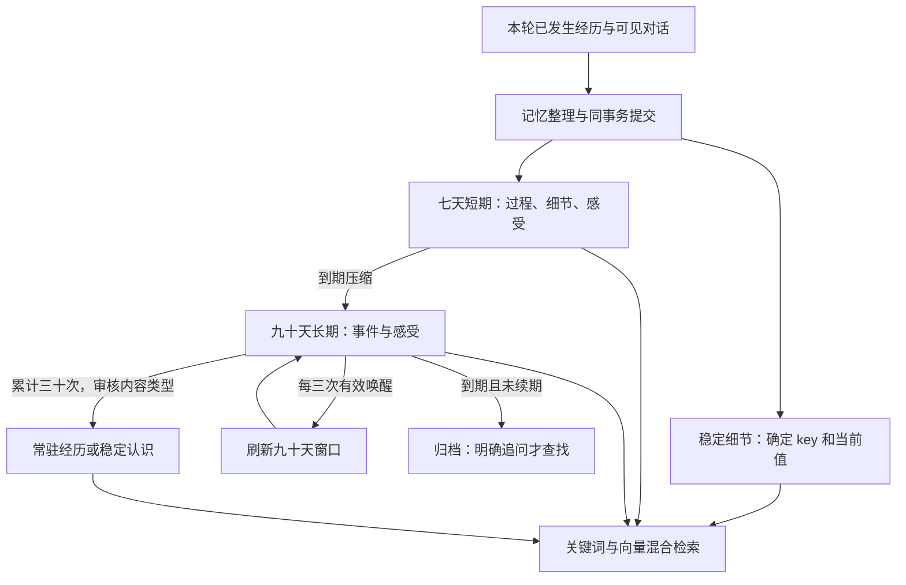

# HDSI 记忆系统 V0.3 方案草案

日期：2026-10-07。状态：供讨论，尚未实现。本文提出长期运行的记忆改造方案，不替代当前 [V0.2 记忆实现说明](../REMAKE_V0.2_MEMORY.md)，也不表示现有代码已经具有以下能力。

## 1. 目标与建议

目标是让 HDSI 连续运行几个月后，仍能按语义想起相关经历，保留准确的生活细节，并让日常经历从较详细的近期记录逐渐压缩成“发生过什么、当时有什么感受”。数据可以持续积累，但每轮提供给模型的内容有明确上限。

建议采用五层结构：**核心设定、稳定细节、七天短期经历、九十天长期经历、常驻记忆**。长期经历和稳定细节接入 Embedding，短期经历也使用同一套索引以支持七天内的相关检索。原始记录留作追溯。

用户提出的 7／90／3／30 可作为首版参数，但建议作三点调整：

1. 稳定事实不因九十天未提及就忘掉；Embedding 帮助查找，确定 key 与当前值帮助保持一致。
2. 只有本轮真实重谈或新经历触及旧记忆才算唤醒。检索命中、模型读到资料和后台压缩都不增加次数。
3. 三十次唤醒达到“常驻候选”条件，不直接写进原角色背景。具体经历可以长期保留，反复形成的偏好可以提炼，但次数本身不能改变人物身份或性格。

本文各参数和规则均为推荐草案，可以在实施前调整。原始记录默认不物理删除；“退出短期／长期”指退出该层的日常检索。

## 2. 现在的系统实际做什么

| 现有类别 | 当前实现 | 与本方案的差异 |
| --- | --- | --- |
| 背景 | 从背景文件载入，每轮提供给有关模型 | 还没有核心设定与可检索背景细节的分拆 |
| 稳定细节 | 独立 details 表、确定 key、一个当前值、别名和变更历史；关键词检索最多 12 项 | 没有语义向量，不随时间过期 |
| 近期原文 | 最近最多 30 条已看输入及实际输出 | 不是七天全部聊天，也不是短期摘要 |
| 短期摘要 | 最近七天最多 12 条，按创建时间选择；离开窗口后仍在数据库 | 没有按事件组织的详细记录，也没有七天到期自动压缩 |
| 长期摘要 | 每轮整理可直接创建；按关键词、重要度、提及次数和时间排序，最多 8 条 | 没有九十天过期或固定次数续期 |
| 加强 | 每轮同 ID 最多一次；增加 mentions、更新 reinforcedAt | 创建时 mentions=1，所以不能直接当作新增方案的唤醒次数 |

目前长期排序中的 `/ (1 + 距最近加强天数 / 90)` 是衰减参数，**不是九十天保留期限**。短期七天仅为检索窗口，**不是七天后自动转长期**。

现有整理只处理已经发生的经历、首次可见输入和实际已发送输出；新建记忆／细节变更至少引用一个本轮来源；计划与未发草稿不能建立事实。这些规则继续保留。

实现依据：`src/memory/context.ts`、`src/memory/organize.ts`、`src/model/contracts.ts`、`src/recovery.ts`。上一轮已把记忆整理预算分开，本方案继续沿用这个方向。

## 3. 方案选择

| 选项 | 做法 | 适用性 |
| --- | --- | --- |
| 最小改造 | 只给已有长期摘要和 details 加向量，继续沿用当前加强规则 | 代码少，能改善语义检索，但无法实现七天压缩和清楚的保留规则 |
| 分层改造（推荐） | 保留现有事实表和事务边界，增加经历结构、压缩任务、向量索引和保留计数 | 覆盖用户目标，改动集中在记忆及宿主维护入口 |
| 每日全量重写人物档案 | 每天把所有经历总结成一个背景文件 | 难以保持具体来源和旧事实，重复改写也容易让档案膨胀，不建议 |

推荐第二种；暂不增加独立向量数据库、额外事实审核模型或多层人物性格演化系统。

## 4. 五层数据如何分工

| 层级 | 放什么 | 保留与提供方式 |
| --- | --- | --- |
| 核心设定 | 身份、主要性格边界、关键过去、基本关系、不可违背的创作约束 | 不自动过期，每轮提供；由用户维护 |
| 稳定细节 | 手机品牌／型号、室友姓名及专业、房间位置、已明确的偏好等 | 不自动过期；确定 key 保存当前值，关键词与向量混合检索 |
| 短期经历 | 具体事件过程、相关人物、可记住细节、当时情绪／主观反应 | 最近七天较详细；按最近性和相关性选取，不全量注入 |
| 长期经历 | 较简短的事件／经历与对应感受 | 默认九十天日常可检索，可通过有效唤醒续期 |
| 常驻记忆 | 经常被真正重谈的重要经历，或从反复经历中明确形成的稳定认识 | 不自动过期；经历仍按需检索，少量简短稳定认识可常驻提供 |

核心设定与稳定细节是信息种类的区分，不是“重要／不重要”的绝对评价。姓名虽然字数少，却需要准确；专业可能对学业情节很重要，也可以通过相关检索提供，而不必整份背景每轮重发。



### 4.1 手机、室友等是否放进 Embedding

建议放，但保存方式仍以 facts/details 为准。比如：

```text
key: roommate.linqing.major
当前值: 软件工程
别名: 林清、室友、专业、学什么
用于向量的文本: 室友林清的专业是软件工程。
```

“你室友学什么”可以靠语义找到该条；返回给模型的事实始终来自它的当前有效值。以后换专业，更新同 key、保存历史、重算当前向量；普通查询不召回已失效旧值，明确问“以前”时才查历史。

一条事实只需要确认一次就应保存，不需要先达到三十次提及。专业、手机型号等客观事实不使用长期经历的过期规则。

### 4.2 背景文件的拆分

保留用户原设定文件作为作者资料。实施时另生成经用户检查的核心设定摘录及稳定细节初始表，模型日常使用核心摘录和相关细节；不一边继续全量注入原背景，一边再检索重复内容。

细节变化必须覆盖运行中的当前事实，不能让原背景中的旧手机型号再次覆盖当前值。核心摘录应避免保留会变化的细节，完整原文件用于人工追溯，不作为每轮同时生效的另一套事实。

## 5. 短期记忆：七天内较详细，以事件为单位

不建议每轮都建立一个全新的“今天聊了一句”记忆。由现有记忆整理模型判断本轮是新增事件、延续已有事件，还是没有值得保存的新内容。

短期条目建议包含：

- 事件主题、开始及最近真实发生时间、人物与地点。
- 已发生过程和结果，必要的可记住细节。
- 角色当时的情绪／感受及原因；资料中没有表达时允许留空，不补造。
- 本轮引用来源及已有条目关联；延续同一事件时增量更新。

通常一条约 150～350 字足够，不要求为了填字段写长。结构上区分客观事实和主观感受：觉得同学冷淡，不等于已证实同学讨厌她；考试时紧张，不等于考试结果差。历史情绪也不自动覆盖当前 emotions 状态。

建议七天以最近一次**真实事件更新**为锚点，使用连续 7×24 小时。仅检索、重新查看或无新事实的重谈，不延长详细记录窗口。一个持续进行的事件可以更新窗口；记录仍需控制篇幅，较早过程可局部收束。

每轮提供“最近几条 + 与本轮有关的几条”，合计先沿用最多 12 条候选。七天的数据总量可以超过 12，12 是模型上下文选取上限，不是数据库条数上限。

未来预约、未完成约定和当前活动仍由现有 tasks／character state 持有，不因短期退出而消失，也不提前写成已经发生的经历。

## 6. 七天后：压缩并退出短期

短期记录到期后，由低频压缩任务处理，生成较简短的长期记忆。目标是保留“什么经历、有什么感受／影响”，而不是把详细短期全文换个标签继续保存。

例如：

```text
短期：上午考试过程、几道题没把握、走出考场后的反应，
      用户怎样安慰她，以及她由紧张到放松的具体经过。

长期：那次考试后我很担心结果，你耐心听我说，陪我吃饭，
      我觉得被理解，心情慢慢放松下来。
```

长期通常约 40～120 字，保留事件时间、人物、主题及来源关联；没有确立感受时只写事件。不得新增结论，也不得把“当时觉得安心”压成“用户永远可靠”。

处理规则：

1. 每个到期事件都有明确处理结果：生成／合并长期记录，或明确丢弃没有持续意义的琐碎内容。
2. 普通有内容的事件默认留一条简短长期摘要；同一天同主题的琐碎日常可以合并。无需把每次寒暄都变成长期条目。
3. 已有同事件长期记录时更新或合并，不能再创建一份并分别累计唤醒。
4. 短期记录标记为已压缩并退出短期检索，原详细记录作为归档保留。
5. 手机型号等已经确立的事实独立保留在 details，不因事件被压缩丢失。

明显重要的新经历可以像现有实现一样直接建立长期记录，同时保留七天详细记录；到期时关联同一长期 ID，不再建立重复记录。直接长期的保留起点是首次建立时间，后续压缩不算唤醒、不自动续期。

普通到期新建长期的保留起点建议取短期到期时间，而不是补跑任务的当前时间，避免停机三个月后凭压缩任务把所有旧事都变成“刚记住”。已经超过期限的补跑结果直接归档。

## 7. 长期九十天与三次唤醒续期

### 7.1 “保留九十天”的具体含义

新长期记录从上述保留起点获得 90×24 小时的日常检索期。到期且未续期时标记 archived，普通主题检索不提供它；不物理删除原始经历和摘要。

这是让角色日常不再容易想起，不是清空数据库。明确问“去年那次……”“你还记得那件事吗”时可以进入归档查找；初期不需要自动检索所有已归档记录，也不把归档详情常驻提供。

归档检索到记录仍不算唤醒。只有后处理确认本轮真实重谈该旧事、有本轮依据，才重新激活并从本轮时刻给予九十天，新增一次有效唤醒。归档重新激活后的本窗口次数设为零，避免同一次重谈同时被用作激活和下次续期的一部分。

### 7.2 唤醒如何认定

沿用现有“整理模型提出 reinforce、程序验证并提交”的结构。必须提供所引用记忆 ID 和至少一个本轮经历／首次可见输入／实际输出来源，说明本轮怎样触及该记忆。

计数不能因以下行为增加：向量命中、进入提示词、生成查询、定时压缩、模型只是把旧资料再总结了一遍、仅把 reconsiderMessages 当新来源。单纯因检索提供了资料而在回复中复述，也不能借 outgoing 来源给自己制造一次加强；需要当前真实话题或新经历支持。

首版建议同一记忆每故事回合最多一次，**同一自然日最多计一次**，自然日按 Asia/Shanghai。当天可以多次真实重谈，但计数只增加一次，避免一场长对话几轮就触发三次续期。该日限制也作用于常驻候选的累计次数，是可调整的建议参数。

### 7.3 两个计数器，避免歧义

| 字段 | 含义 |
| --- | --- |
| totalAwakenings | 从创建后发生的有效唤醒总次数，初始 0，续期时不清零 |
| awakeningsSinceRenewal | 上次获得／刷新保留期后积累的有效唤醒次数，初始 0 |
| retainedFrom | 当前九十天窗口的起点 |
| expiresAt | retainedFrom + 九十天 |
| lastAwakenedAt / lastCountedLocalDate | 最近有效唤醒与当日去重依据 |

活跃记忆每次有效唤醒增加两个计数。当 awakeningsSinceRenewal 达到 3 时，把 retainedFrom 改为本轮时刻，刷新 expiresAt，并将窗口计数清零。只有一次／两次唤醒不会刷新期限，符合“三次后续期”的想法。

例：10 月 14 日进入长期，原到期是 2027 年 1 月 12 日；10 月 20 日、11 月 2 日、11 月 15 日各有效唤醒一次，第三次将到期刷新为 2027 年 2 月 13 日，总次数为 3、窗口次数为 0。

若最终更希望“每次有效唤醒就续九十天”，可以简化掉窗口计数器。它更接近现有 reinforcedAt 的做法；本草案优先采用用户提出的三次规则。

## 8. 三十次后如何常驻，而不污染角色设定

建议达到 **30 次有效唤醒**时产生常驻候选，仍由压缩／整理任务判断内容类型。阈值表示 ≥30；若用户希望严格“大于30”可改成 31。

候选有两个出口：

1. **重要经历常驻**：保留简短经历，不再九十天过期，继续按语义检索。比如常常提起第一次一起过生日。它是重要回忆，不是人物身份设定。
2. **稳定认识或偏好**：从多个有依据的经历提炼成可修订的小条目，例如“难过时更愿意先被倾听”。必须有跨事件支持，不能把一件事重复三十次当作三十件独立证据。

达到次数只触发检查，不强制一定生成条目。反复提及的尴尬经历、一次误会或持续反刍，不应自动升级成“固定性格”。明确的客观细节则早已存在 details，不必等三十次。

运行生成的常驻内容保存在独立 learned_background／durable memories，不自动修改 `梁思璃设定.txt`。少量“稳定认识”可设置 alwaysInclude，建议常驻文字总额最多 800 可见字符；超出后按本轮相关性提供。具体常驻经历只按需检索，避免日后数百条记忆全量注入。

常驻不代表不能变。新事实可以修订稳定细节；新的有依据经历也可以更新认识。常驻经历不再计算九十天续期窗口，但可以继续累计有效唤醒次数。涉及身份、作者指定性格和关键过去的变更留给用户，不由记忆次数授权。

## 9. Embedding：混合检索，事实仍有确定入口

### 9.1 模型与存储

首版建议沿用当前已经验证的 `qwen3.7-text-embedding`、1024 维，复用 HttpEmbeddingProvider 的请求实现，另设 memoryEmbedding 配置，允许以后与表情包独立选择模型／端点／维度。阿里云官方接口文档列明该模型支持 1024 维及兼容 Embeddings 接口：[同步接口 API 说明](https://help.aliyun.com/zh/model-studio/text-embedding-synchronous-api)。这证明接口能力，不是 HDSI 记忆检索质量验收。

表情与记忆的向量索引、输入模板和查询缓存分别保存。模型、维度或输入模板变更后显式重建记忆索引，不混用旧向量；同为 1024 维不表示不同模型向量可互比。

SQLite 保存文本、事实和向量派生索引，初期在程序内计算余弦相似度；先用 SQL 按种类、有效期和状态筛候选，再取向量。运行数月的实际条数与耗时应测量后决定是否需要向量扩展，不先引入独立服务。

1024 维 float32 原始向量约 4 KiB，一万条约 39 MiB，未含文本、SQLite 索引和元数据；若直接保存 JSON 数字数组，占用会更大。新索引建议使用 float32 BLOB，业务数据仍可沿用当前 JSON 行。

### 9.2 索引文本

- 稳定细节：主体 + 属性 + 当前值 + 必要别名。
- 短期：事件主题 + 过程／结果 + 已确立感受。
- 长期／常驻经历：简短事件 + 感受／影响 + 人物和主题。

只向 Embedding 发送所需记忆文本和事实文本，不发送整个原始聊天库或完整背景文件。日期、状态、次数和 key 仍作为结构化字段，不靠模型向量来判定是否过期或哪个版本有效。

### 9.3 检索过程

1. 先沿用既有可见性规则构造查询：普通主叙事不能用本轮未看私聊；个人导演只用实际可见输入；整理只用本轮合法来源。
2. 每轮按任务查询生成向量，同一文本／模型可短期缓存复用；没有实质查询时只取近期内容，不为凑查询调用模型。
3. 确定 key／明确别名命中，以及关键词相关候选，与向量候选并集。稳定事实的确定命中优先，不因时间久或低向量分数被忘掉。
4. 长期等先排除不在日常有效期的记录；明确历史追问才查归档，明确旧值查询才查 detail_history。
5. 对候选按关键词与向量两路排名合并，例如使用倒数排名融合，避免拿两个数值范围不同的分数直接相加。保留主体／时间信息，由模型判断是否与当前话题有关。
6. 去重同事件、同事实 key 和同来源的短长版本，再按数量及字符预算提供。历史情绪不能当作当前状态。

记忆检索可以返回空。不能复用表情包“无阈值、总选最高一张”的规则，避免话题不相关时也塞入一段旧事。向量相关性下限应通过真实记忆查询样本标定，不能凭空给一个通用余弦阈值；词法明确命中有独立入口。实施阶段需用相关与无关问题一起评估后冻结参数。

先不加独立 LLM 查询改写和 rerank 模型，主叙事／个人导演按已有任务构造查询即可。Embedding 能改善措辞不同的召回，不能保证事实正确或理解每个故事指代。

## 10. 上下文预算与整理职责

生成端仍保留最近原文，Embedding 不替代即时对话上下文。建议首版候选数量继续从 30 原文、12 短期、12 细节、8 长期／常驻经历起步，后两种经历共用 8 项额度。

可继续使用默认 8000 可见字符的历史预算，但分块裁剪。示例份额：原文 3000、短期 2500、细节 1000、长期／常驻经历 1500；未用份额可调给其他块。这些是测试起点，不是必须照搬的最终数值。核心背景、当前状态、当前来源仍另行提供，不能通过预算删掉本轮控制信息。

记忆整理单独构造上下文，提供本轮来源、相关已有短期事件、相关细节、相关长期及候选常驻认识，不加载与整理无关的全部近期历史。保留上一轮独立预算的修正，避免再次把无用字段计算进去。

现有 `memory` 任务继续每轮整理，增加“更新已有短期事件、带当前来源的唤醒、常驻候选”等输出。低频新增 `memory_consolidation`，负责到期压缩／合并／候选提炼；连接独立配置，建议初始同为 DeepSeek Flash、high，可单独改 Pro。Embedding 没有思考强度。

重要度仅影响相关候选中的排序，不让无关的重要经历每轮强行进入上下文。次数应使用有上限的排序加成，不能让经常被提到的记忆永久挤掉其他相关内容。

## 11. 与现有冻结、后处理和串行宿主衔接

### 11.1 每轮新增／修改记忆

保留现有“模型结果先存 post job，正式效果与 done 同事务”的段 B。短期更新、事实变更、唤醒计数和常驻变更都在该事务中提交；恢复复用结果，不重复计数。

每轮整理新条目仍至少引用一个本轮合法来源。更新已有事件必须引用已有事件 ID 和当前新来源，不能只根据旧全文重新输出一个副本。新增唤醒也需当前来源，并按 turn ID／本地日期去重。

### 11.2 向量是派生索引

业务提交同事务登记“哪个条目的哪个版本需要建索引”；在线 Embedding 在事务外执行，完成后只为该版本保存向量。正文更新、过期或归档时，旧向量不能继续作为当前有效记录返回。

没有就绪向量的条目仍可通过确定 key、别名和关键词找回。单次 Embedding 失败记录待办，后续重试，不撤销已完成故事或重发 QQ。它不能像必需的本轮角色输出失败一样把故事段 B 回滚。

为保留单进程串行结构，首版不另开并发故事写线程；在轮间及空闲定时唤醒时执行有限批次索引待办。查询向量失败时走已有词法检索并记录状态。表情包当前失败处理不在本方案里顺带改变。

### 11.3 到期维护

建议每天按 Asia/Shanghai 在 04:30 进行一次记忆维护；睡眠期间可以维护记忆，不生成新私人经历或推进 narratedUntil。停机错过后，下次启动补处理到期数据，不补模拟每天的生活。hdsi.pause 同时暂停新压缩任务，已经开始的任务允许完成，恢复后补办；不再增加一套维护控制命令。

启动仍先续办未完成故事轮，再续办未完成记忆维护，随后处理到期维护及原环境／故事调度；不得在旧冻结轮尚未提交时先改写其依赖的正式记忆。

维护按事件最多 20 条一批，只提供到期短期正文、已关联长期和必要事实，不把几个月聊天全文发给模型。批次保存选定 ID／版本、到期时间和结果，处理完一批继续下一批；只有存在实际到期内容／常驻候选才调用模型。维护本身不建立“角色今天回忆了一下”的故事经历，也不增加唤醒次数。

压缩结果可以引用该维护批次的既有来源及记忆 ID，不受“只能引用当前故事新来源”的合同误限制；这是单独 maintenance 合同，不放宽每轮 memory 的来源规则。正式应用与任务 done 同事务，恢复不生成重复长期条目。

短期／长期检索的有效期按时间字段判定，不依赖维护是否及时删除行。待压缩原条目一直保留；补跑优先完成到期压缩后再选择新故事轮，避免新轮把维护未完成误当作内容已永久丢失。

## 12. 建议新增的数据与索引

不要求照此立即写代码，但实施计划应明确以下字段归属。

| 对象 | 建议内容 |
| --- | --- |
| 短期事件 | ID、主题、过程／结果、感受、人物、时间、sourceIds、revision、短期到期时间、关联长期 ID、压缩状态 |
| 长期／常驻经历 | ID、简短内容、感受、主题、sourceIds／来源事件 ID、revision、active/archived/durable、retainedFrom、expiresAt、两个唤醒计数、最近计数日 |
| 稳定细节 | 保留 key／当前值／别名／历史；增加 revision 与向量索引引用，当前值不自动过期 |
| learned_background | 可修订的稳定认识、来源经历 ID、作用范围、是否常驻、版本；与作者核心设定分开 |
| memory_index | ownerType、ownerId、revision、模型／端点／维度／输入模板版本、float32 向量 |
| index_jobs | 正文版本、pending/done、最近错误；登记与正文提交同事务，向量计算在事务外 |
| memory_maintenance_jobs | 选定批次、输入版本、结果、done；压缩和常驻提炼可共用任务框架 |

SQL 提供种类／状态／时间范围过滤、同 key 当前值定位与待办查询，不再每次为找某轮记录扫描整个历史。增加具体查询方法是数月运行所需的常规调整，无需全库架构重写。

对同一事件，短期与长期共用关联，唤醒计在长期 ID；合并前计数迁移不能把同一天重复项相加。首版由整理／压缩模型提出合并，再由程序验证引用和日期计数，不建立全库自动聚类任务。

## 13. 迁移与验收

迁移保留已有 messages／experiences／details／detail_history，不重新识别表情，也不改模型和凭据。已有长期摘要建立向量；旧 mentions 含创建次数且没有按新规则记录的逐日唤醒凭据，不能直接当 totalAwakenings，建议新计数从零开始，保留旧 mentions 作历史字段。

已有长期记录首次迁移时建议统一给予迁移起的九十天观察窗口，作为一次明确迁移例外；后续到期压缩使用真实短期到期锚点，不能每次重建向量都重开窗口。旧短期记录按是否仍在七天窗口决定活跃或待压缩，不因迁移把旧聊天变成新事实。

实施前应以正常使用样本验证：

1. “室友学什么／她的专业”能找回同一当前事实；手机换机后普通查询只拿当前值，历史问题能拿旧值。
2. 同事件短期增量更新、七天到期压缩、直接长期与到期长期合并均有唯一结果；重启不重复压缩。
3. 长期过期退出日常检索；三次跨日有效唤醒续期；检索命中与同日多轮不加次数；日期按配置时区。
4. 三十次只生成常驻候选，不能自动覆写核心设定；跨事件稳定认识与单个反复提及事件正确区分。
5. 未看输入不进入查询、索引或记忆来源；旧重考虑原文不能单独提供新来源。
6. 段 B 恢复不重复唤醒，维护恢复不重复创建，索引失败不重发或撤销已提交故事。
7. 三个月和六个月规模样本的召回、误召回、每轮字符数、查询延迟与在线调用次数。用几十组问题比较现有关键词与混合检索，而非只证明接口返回了向量。

建议分三步实施：先给现有 details／long memories 加独立索引与混合检索，再实现详细短期及到期压缩，最后增加唤醒续期与常驻候选。每一步都保留原故事冻结与段 B 事务约束，单独可验收。

## 14. 需要用户审阅的主要选择

本草案推荐：七天详细短期；九十天日常长期，到期归档而非删除；三次有效唤醒续期；同日最多计一次；三十次产生常驻候选；客观细节不按九十天过期；原作者设定不自动写回。

其中“同日计一次”“归档可在明确追问时重新找回”“三十次只是候选”“琐碎日常允许合并或不进入长期”是结合现有结构补充的设计判断，并非用户已确定的要求。它们旨在避免一次长聊天把计数刷满、重复摘要膨胀及高频话题改变人物设定。

用户审核本方案后再形成实施细化和配置参数；本次只交付方案文档，不修改程序、私有背景、配置或数据库，也不调用在线 Embedding。
