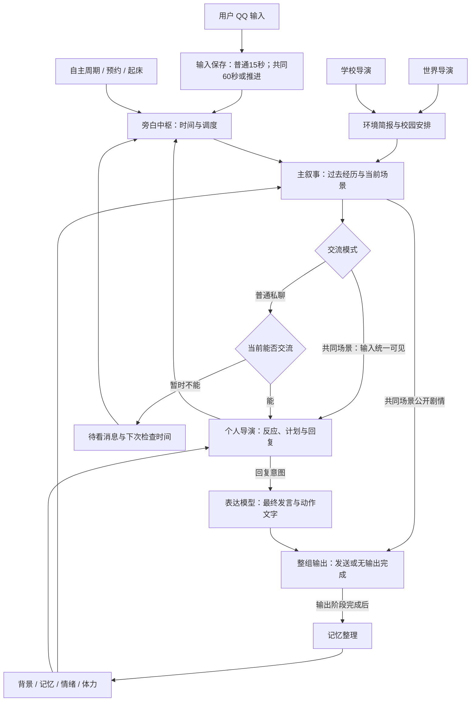

# HDSI 重制方案 V0.2：总架构

> 历史累积文档：2026-10-09起当前架构说明由[V0.5总架构](docs/v0.5/architecture/REMAKE_V0.5.md)及其子系统文档替代。本文保留各次修改、旧规则和当时证据，不再作为当前系统入口；请勿将旧正文与最新规则混用。

2026-10-09普通窗口／活动上下文：独立普通chat索引版本2，最近4个完整普通段，普通实际交互空闲15分钟关闭；活动整体不计入4段、不延长普通锚点。活动工作阶段保留完整授权原文，结束后的普通任务只经统一记忆检索召回，迟读活动输入仍直接提供。见[提示词上下文实施细化](docs/PROMPT_CONTEXT_OPTIMIZATION_V0.1_IMPLEMENTATION_20261008.md)与[本批验收](docs/PROMPT_CONTEXT_OPTIMIZATION_V0.1_DELIVERY_REVIEW_20261008.md)。

日期：2026-10-07。状态：已按实际实现核对的架构说明；核心代码与离线验证完成，真实 QQ 和完整故事路径待联调。

本方案整理自 V0.1 讨论记录，现已同步当前代码、测试和部署配置；核对以实际实现为准。原始 HDS Interlude 和本地增强版仅供历史参考，不承担兼容旧架构的要求。


共同活动V0.3于2026-10-08按新细化实施；当前离线证据见[共同活动实施记录](docs/SHARED_ACTIVITY_V0.3_IMPLEMENTATION_LOG_20261007.md)。真实隔离多轮与正式库停服升级已验收，记录见第十轮与本批提示词／上下文交付；QQ收发仍待联调。

## 1. 想做成什么

面向一个用户、一个角色的 QQ 私聊生活模拟系统。角色是一名学生，有自己的日常、选择、情绪和记忆；用户通过对话与她建立持续关系，也能参与共同的虚拟活动。

技术组合保留 SnowLuma + Koishi + HDSI 重制插件。世界、学校和个人生活由不同粒度的模型任务生成，程序负责时间、消息接收条件和调度。一个插件、一个进程、一份故事状态即可。

本文说明已实现的核心行为、模块边界与阶段恢复。新 Koishi 位于本目录 `runtime`；67 张旧表情图片、描述、标签和兼容向量已复制并导入，没有迁移旧聊天、记忆或人物状态。恢复覆盖输入保存、发送续办和本地效果提交，不扩展多机或完整生产防御体系。部署见 [README](README.md)，本次核对及 DSH 审核入口见 [文档核对与审核清单](docs/v0.5/README.md)。

成功标准是：

- 角色在不聊天时仍有生活，聊天时知道刚刚经历了什么。
- 洗澡或睡觉时不会提前读到消息；能看到消息也可以选择不回复。
- 约定能够在约定时刻触发，不受三小时生活周期限制。
- 双方共同经历的剧情会在 QQ 中公开，双方基于同一场景交流。
- 手机品牌、室友姓名等已经确立的细节能保持一致。
- 模块少、状态归属清楚，不为了模拟真实生活而堆叠大量独立系统。

## 2. 阅读导航

| 文档 | 内容 |
| --- | --- |
| 本文 | 目标、职责、主流程、设计取舍、实现顺序 |
| [生活与共同场景](REMAKE_V0.2_LIFE.md) | 导演、主叙事、旁白、睡眠、预约、共同活动、概率 |
| [记忆与角色状态](REMAKE_V0.2_MEMORY.md) | 背景、固定细节、短期/长期记忆、情绪、体力 |
| [接口与代码组织](REMAKE_V0.2_INTERFACES.md) | 实际数据结构、模型接口、存储和代码目录 |
| [阶段回退与中断恢复](REMAKE_V0.2_RECOVERY.md) | 最低恢复骨架：输入保存、发送冻结、逐项确认、后处理一次提交 |
| [实施细化与开发记录](REMAKE_V0.2_IMPLEMENTATION.md) | 实际运行数据、调度、睡眠、检索和概率、逐模块落地与待验收项 |

一个规则只在所属文档详细定义，其他文档引用它。

## 3. 已确认的方向

以下来自 V0.1 及本轮用户补充的明确要求：

1. 只做单角色一对一私聊，不需要群聊和合并转发。
2. 世界及三个学校步骤按故事时区每日06:00顺序检查，争取07:00完成；清醒期间的个人自主生活间隔默认均匀抽取 150～210 分钟。
3. 每次个人导演运行前，主叙事先生成从上次运行到现在的经历；个人导演负责反应与接下来的意图。
4. 主叙事同时负责共同活动，公开剧情使用 `【】`。
5. 线上共同活动仍是远程聊天；线下活动中的 QQ 文字代表当面发言，允许 `【动作：……】`。
6. 情绪名称由模型自由生成。体力与情绪跟随事件变化，不按固定时长自动降档或归零。
7. 预约按实际时间触发，不设最小间隔。
8. 控制格式出错时返回模型修补，不用默认值掩盖；多次修补失败，QQ 输出系统 `error` 并暂停插件的故事调度与角色回复，保留可恢复记录。
9. 普通用户连续输入以末条后15秒合批；共同输入立即保存，由双方最近输入／确认输出后默认60秒或全文`【推进】`选轮。首节点立即，普通活动提示词以约10轮自然收尾为软目标、目标前2～3轮开始收束，无最少轮数要求；最多20个成功共同轮为硬上限。
10. 回复通常由多段短话组成，段间等待按字数线性对应：1 字 3 秒、25 字 10 秒。完整规则见[生活方案的回复分段](REMAKE_V0.2_LIFE.md#32-回复分段与发送节奏)。
11. 程序处理、发送或记忆整理中断后，重启能从已保存阶段恢复：发送前可从原输入重做，发送开始后保留原稿续发，发送完成后只恢复后处理。
12. 发送结果无法可靠核实时，自动重发该未知段并继续，接受未知段可能重复；已经明确确认的段落不重发。
13. 私人生活意图作为文字叙事背景，不登记私人活动定时任务；双方确认的共同约定登记预约。
14. 线上和线下合法共同场景中，本次选择固定的输入统一可见，不套手机或旧睡眠计划门禁。程序按冻结权限选择提示：双方无新输入允许公开代写双方活动内行动；有输入禁止新增用户动作。公开代写按共享模拟经历记忆，不新增真实用户稳定设定；角色台词、心理及后续意图仍由个人导演负责。
15. 普通睡眠终止自主周期，起床重新安排，不补跑夜间轮。实际前台主叙事成功提交后统一从completedAt重设150～210分钟空闲自主周期；共同／合批／可运行前台抑制自主，前台优先于未开始环境，环境优先于空闲自主。

体力四档、记忆检索、代码目录和概率曲线已经落地；后续调整需要同步实现和所属文档。

## 4. 最小职责划分

| 模块 | 是否调用模型 | 负责什么 |
| --- | --- | --- |
| 旁白中枢 | 否 | 连续输入合批、时间、调度、睡眠、接收条件、待看消息、预约、概率、应用模型结果 |
| 世界导演 | 是 | 低频生成公共环境简报，必要时使用联网资料 |
| 学校导演（校园／课题组／周计划） | 是 | 持续学期与研究安排、稳定周实例及通知候选，角色自由选择；程序保存／发布，实际获知才提交知识 |
| 主叙事 | 是 | 实现已经过去的生活过程、行动结果、当前场景、共同活动公开剧情 |
| 个人导演 | 是 | 角色的主观反应、情绪、意愿、行动计划、是否回复及回复意图 |
| 记忆整理 | 是 | 整理经历和对话、提取稳定细节、详细短期、预备长期与合法唤醒；常驻判断由后台负责 |
| 表达模型 | 是 | 在角色草稿基础上微调语气、句长、口语感、动作呈现与分段 |
| 发送与素材 | 素材入库时使用模型 | QQ 文本分段、表情包检索与发送 |
| 存储与恢复 | 否 | 保存正式状态、原始输入、回合工作区、逐段发送记录与后处理待办，恢复未完成阶段 |

“情绪系统”“体力系统”“概率系统”“预约系统”都是插件内的小模块或状态字段，不另建进程，也不各自配一个持续运行的模型。

个人导演按普通聊天、私人生活、共同场景选择小契约；计划、睡眠和共同模式等变化按需输出，不要求每轮填满所有字段。普通聊天仍允许提出出门、早睡或开始共同活动。主叙事也分别使用普通经历和共同场景契约，普通回合不输出公开剧情。

### 独立表达模型

用户已确认保留独立表达模型，并统一草稿默认方式：个人导演决定是否说、想说什么、以什么态度回应及采取什么动作，需要角色输出时提供初版草稿；普通回复、共同活动反应、主动联系都按这一方式。表达模型读取意图、草稿、当前情绪、场景和聊天范例，微调为最终文字。

表达模型可以调整措辞、句长、口语感和动作呈现，保留草稿中的信息、态度与承诺，不重新决定考试结果、是否答应邀约或是否愿意回握。草稿已经合适时允许原样输出。它只在需要输出角色发言或动作时调用；沉默回合不额外调用。发送器只负责展示和素材发送。

## 5. 架构图



图中的“当前能否交流”约束普通私聊输入。主叙事先依据生活背景生成当前处境，再由旁白判断普通私聊可见性；共同场景的本轮输入统一可见，直接进入主叙事和个人导演，不经过手机门禁。清醒且暂时看不了手机的角色，仍可在自主生活回合运行个人导演，只是不注入未看消息；睡眠期间暂停个人导演并终止自主周期，起床后重新安排。

记忆整理只由整组输出完成触发；无输出回合直接完成输出阶段再整理。主叙事经历是整理的输入材料，不是提前启动整理的另一条入口。

## 6. 一条主流程

程序维护当前真实时间和故事已经叙述到的时间。每次准备运行个人导演，先运行主叙事；主叙事只实现已经过去的过程，不提前生成下一段生活的结果。

```text
时间或已结束等待的消息批次触发
  → 保存本轮输入、处理时间与触发来源，在工作区计算到期状态
  → 按交流模式装配输入：普通主叙事不读新私聊正文，共同主叙事读取本轮场景输入
  → 主叙事根据背景与文字生活意图补齐尚未叙述的经历，给出当前场景
  → 旁白应用场景，判断普通私聊可见性；共同场景不再次判断可见性
  → 个人导演理解经历和已看消息，生成反应、下一步计划与回复意图
  → 旁白保存文字生活意图，形成预约等任务候选，表达模型生成需要发出的角色文字
  → 一起保存完整候选、发送清单与后处理待办，再开始发送
  → 发送器公开共同剧情，再按短段及字数间隔发送角色发言，逐项保存确认
  → 整理本轮经历与实际对话
  → 一次短事务提交故事状态、记忆、稳定细节、预约等变更和完成标记
```

普通私聊明确处于睡眠或已实现的不可接收活动区间时，新消息先暂存，不为了这条消息运行个人导演。到预计活动结束或起床再更新场景、检查可见性并走上述流程。私人意图中的未来活动不是已经发生的当前活动，不由程序定时把意图转换为事实。

共同活动回合中，主叙事的公开剧情先发到 QQ，随后发送角色对此的反应。后台的私人生活摘要不自动公开，只由角色选择是否分享。

同一故事按回合串行推进，旧轮的发送及后处理完成后才开始下一轮；新消息仍立即保存，普通输入合批、共同输入按活动时钟等待。先补上次已提交narratedUntil到本轮at之间的生活；环境及纯暂存不推进此字段。恢复规则只在[恢复专题](REMAKE_V0.2_RECOVERY.md)详细维护。

## 7. V0.2 对讨论稿的主要整理与改进

| 讨论稿中的问题 | 本版处理 |
| --- | --- |
| 曾出现“个人先运行，再生成这次行动结果” | 改为“主叙事实现上一段经历，个人决定下一段计划” |
| 私人生活意图与共同约定的调度混在一起 | 私人意图保留文字背景，由主叙事生成当前活动；共同约定单独登记预约，旁白读取当前活动的时间与手机条件 |
| 主叙事可能越过角色职责 | 普通／有输入轮角色自愿反应交个人导演；静默共同轮可公开实现双方活动动作，角色感受、台词及后续意图仍由个人导演决定 |
| 不可接收与不想回复混在一起 | 旁白决定能否看见，个人导演决定看见后是否回复 |
| 固定细节既建议全量注入，又要求按需检索 | 核心背景常驻，新增细节按需检索 |
| 固定信息审核随机跳过 | 合并到每轮记忆整理，允许返回空结果，避免漏掉已经确立的事实 |
| 预约创建后直接进入共同模式 | 到预约时刻再开始场景；角色可以等待、改期或拒绝 |
| 把基础概率再递增，却将基础值称为长期平均 | 分别校准递增曲线；表情包长期目标为“表情包数 / 非线下角色文字短段数 = 5%”，主动联系为合适机会的 15%；具体统计口径见[生活方案第 7 节](REMAKE_V0.2_LIFE.md#7-概率表情包按文字消息主动联系按合适机会) |
| 180±30 被写成高斯标准差 30 | 默认均匀抽取 150～210 分钟，明确符合范围含义 |

上述行为已在当前代码中落地；恢复按本项目的两段流程实现，不照搬旧项目的完整账本与审核链。

## 8. 已采用的实现顺序

1. **生活与聊天闭环**：旁白、主叙事、个人导演、独立表达模型、基础存储、核心背景、近期对话；同时建立输入保存、发送准备、逐段确认与阶段恢复。先证明“过去经历 → 当前反应 → 未来计划”能连起来，且中断不丢输入或重复已确认输出。
2. **时间与共同场景**：活动接收条件、睡眠、预约、线上/线下活动。预约与共同模式一起实现，避免只做一个提醒功能。
3. **持续记忆与素材**：固定细节整理、短期/长期记忆、表情包和主动联系。情绪与体力从第一阶段就作为状态字段使用。
4. **环境扩展**：学校导演、世界导演及可选联网。前期可用人工校园安排验证生活闭环，再接环境模型。

上述四阶段代码已完成。运行细节、测试证据与待实机验收项见[实施细化与开发记录](REMAKE_V0.2_IMPLEMENTATION.md)。十一项DeepSeek任务均Flash：八项low，记忆整理／记忆压缩／新图描述high，可独立换Pro。记忆和表情各自配置Qwen；混合检索与前台优先后台已落地，真实语义阈值待标定。

## 记忆V0.3实施增补

一个故事槽与一个后台准备槽共存，后台不阻塞聊天；七天详细短期／预备摘要／90日长期／跨日3次续期／30日常驻候选见记忆落地。默认人工输入预算关闭，相关性先于RRF。当前记忆已实现，网络搜索按独立六任务继续，真实provider稍后确定。


## 搜索离线核心落地（2026-10-07）

进程内唯一WebSearchService及四辅助表web_sessions/web_operations/web_materials/self_web_read_sources已接入。全部十一类任务独立run身份，阶段输入、补查、修补和工具请求检查点私有；公开正文缓存按owner释放，数据库材料保留恢复。同阶段重放计0，跨阶段首次取得各计1。正文响应成功后、最终parse前登记实际提供；personal_life的稳定来源及首次operationId进入post job。环境合同在最终parse读取providedUrls。后台共用既有120秒准备槽／signal，不阻塞前台，stop取消后不保存晚结果。

真实provider未配置，webSearch.enabled=false；当前未联网，待选服务后注入provider。网页无人工字符预算或12000截断，真实容量错误不删内容重试。来源语义、表达不新增事实和查阅不变亲历仍由任务提示约束，程序不冒称能判断散文真假。

证据：[搜索实施记录](docs/WEB_SEARCH_IMPLEMENTATION_LOG_20261007.md)、[审核交付入口](docs/IMPLEMENTATION_HANDOFF_20261007.md)。
