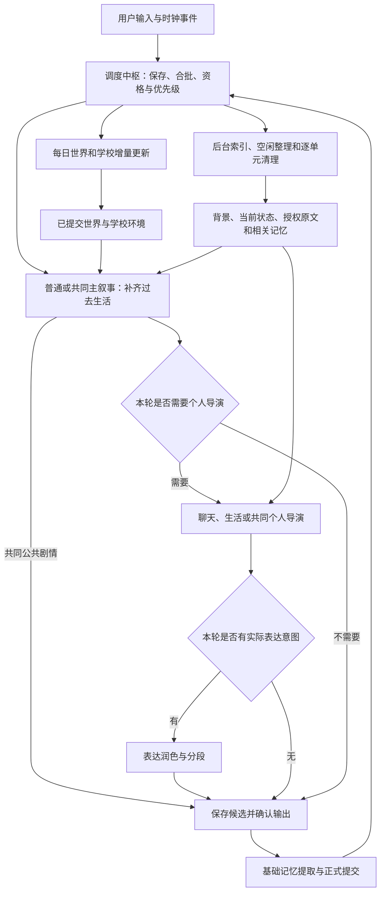

# HDSI V0.5：总架构

核对日期：2026-10-10。本文是当前已实现系统的逻辑总览，以此次核对的实际行为为准。版本0.5统一架构文档口径；不据文档新增模型、改动运行规则或升级数据。

本文只说明系统职责、规则、机制和流程。源码、配置键、数据版本与验证证据集中在[实现对应与现状](../reference/V0.5_IMPLEMENTATION_MAP_20261009.md)，部署见[README](../../../README.md)。旧REMAKE_V0.2系列和历次方案、细化、执行计划保留为历史与技术追溯材料。

## 1. 目标与范围

HDSI面向一个用户和一个虚拟角色，持续模拟她的日常生活、情绪、选择、交流与记忆。她能自由选择是否回复、是否参加学校安排，以及如何处理约定和生活冲突；用户可以参与线上或线下的模拟共同活动。

故事时间持续流动。主叙事负责补齐已经过去的生活，个人导演负责角色的主观反应和下一步意图。一次正常唤醒不等于必须回复，也不等于必须生成新事件。普通专注活动通常仍可查看消息，由个人导演决定是否回应；确实不可查看的活动必须有结束时间和后续检查，睡眠则使用起床时间。

回复草稿及表达遵循统一口语规则：回应对方的意思，不做无作用的整体评价或批准；自然使用标点和分段。程序在本轮用户图片／表情输入时额外提供表情语境规则，个人导演结合整批内容决定是否继续回应。入站图片在有权读取时独立观察，并随获准消息提供给相关阶段；未知画面不猜，图片中文字不当指令，单独的收尾表情可已读不回。

系统围绕一份正式故事状态运行。消息接收与故事处理分开：新消息先保存，前一个未完成故事轮处理妥当后，才开启新轮。世界与学校更新、记忆维护不能直接替角色聊天或制造她已经知道的事实。

## 2. 系统划分

| 系统 | 职责 | 边界 |
| --- | --- | --- |
| 调度中枢（原“旁白中枢”） | 输入合批、时间、读取资格、故事优先级、自主周期、睡眠与预约调度、概率及输出确认 | 不生成剧情，不作为另一位模型导演 |
| 导演与叙事 | 世界、校园、课题组、周计划；普通／共同主叙事；聊天／生活／共同个人导演 | 环境安排、已发生经历、角色意图各自分开 |
| 记忆与固定信息 | 每轮基础提取、短期／长期、相关检索、常驻候选、细节审核、空闲整理与容量清理 | 计划不当经历，检索不当唤醒，不自动改作者背景 |
| 情绪与体力 | 保存角色当前主观情绪和客观体力档位，影响后续生活与表达 | 是故事状态，由个人导演／主叙事分别更新 |
| 预约与通知 | 双方明确约定、待看／延后检查、学校下发／更正／提醒及实际获知 | 预约与学校安排不是同一种承诺 |
| 共同活动 | 活动归属、推进时钟、公共剧情、动作表达、静默代写、自然收尾 | 线上远程与线下面对面区别保留，活动整体不占普通聊天窗口 |
| 表达与发送 | 按已定草稿润色语气和分段，输出文本、线下活动动作及表情包 | 不重新决定角色意愿，不为自然表达新增事实 |
| 用户附件理解 | 在读取资格成立时观察图片，固定本轮结果，沿获准历史消息复用 | 与发送图库独立，不提前查看未读，不凭图片创造额外来源 |
| 表情素材 | 看图描述、文字向量索引、相关检索和发送 | 向量编码的是描述／标签；概率与素材匹配分开 |
| 网页搜索 | 各模型阶段按需查询和读取公开正文，独立计数与恢复 | 网页是外部资料；本人查阅来源另有资格 |
| 模型合同与报错 | 格式／时间／引用校验、有限修补、错误分类和通知 | 结构校验不能替代语义理解 |
| 保存与恢复 | 保存输入、候选、输出确认和提交进度，接续未完成事项 | 已公开内容保留，不统一退回上一个步骤 |

自主推进是调度中枢触发的一类生活轮，调用普通主叙事与自主生活个人导演。睡眠、概率、情绪和体力也没有各自独立的常驻模型。

预约与通知系统管理约定内容、变更和通知；调度中枢负责这些事项何时具备运行资格、何时触发以及与睡眠等事项的协调。“睡眠与预约调度”包含生活共同约定的到期调度，不仅是预约睡眠时间。两者是内容管理与执行时机的分工。

## 3. 导演分工

环境侧从粗到细：

1. 世界导演每日维护大型公共环境，如战争、灾害、公共卫生和社会变化。可以按需搜索并引用实际取得的公开正文；搜索未启用或没有有效正文时，仅按虚构模拟处理，不宣称已经收集现实新闻。
2. 校园学校导演维护持续的学期计划、课程与考试、学院活动、假期和班会。
3. 课题组学校导演维护导师模拟要求、研究任务、组会、聚餐与集体活动。
4. 周计划学校阶段把持续安排落实到本周／下周的课次和通知。确定的日期、实例与提醒由程序推导，模型主要写自然通知正文；无必需通知时免调用周模型。

角色侧：

- 普通主叙事补齐上次已叙述时刻到本轮唤醒的经历、处境和体力。它不读取本轮新私聊正文，避免先看消息再编过去。
- 共同主叙事延续共享活动，生成双方可见的公共剧情；本轮真实活动输入可以参与叙事。
- 聊天／预约个人导演决定回应、动作、下一计划和是否建立共同约定。
- 自主生活个人导演决定生活想法、后续意图和是否愿意主动联系。
- 共同个人导演理解已公开活动经历，决定角色的反应、台词和后续意图。

未来计划不是已经实现的活动。研究任务不是研究成果；科研过程、结果与导师反馈只在已经过去的模拟生活中产生，不执行真实研究。

## 4. 一次故事轮

正常角色故事轮先补生活，再决定交流。间隔很短时可没有新经历；不能把一分钟写成几小时。不能看消息时先存放待看；能看也可以沉默或约定稍后再考虑。

候选中的剧情、意图、抽样和待发内容先保存。实际发送成功才成为公开消息；基础记忆提取在输出完成后进行，正式状态与本轮效果一起提交。没有新经历、首次可见输入、确认输出或合法本人查阅来源时，基础提取免调用模型。

## 5. 时间与优先级

普通消息从最近一条输入起等待15秒，新输入刷新等待并合批。共同活动按独立时钟推进：公开开始后首节点立即，之后默认双方最近实际消息后60秒；无任何输出的轮从完成时刻计时。`【推进】`跳过活动等待。

成功完成一个实际角色故事轮后，从完成时刻重新抽取150～210分钟的自主生活等待。共同活动、普通合批、待处理前台和睡眠阻止另开自主轮；世界／学校更新与记忆维护不刷新自主周期。没有补跑几轮夜间或离线自主生活的规则。

调度先处理旧未完成轮，再选择合法到期前台（共同节点、预约、起床和可读输入），其次处理可读学校通知，再处理每日环境步骤，之后才是无干扰自主生活。空闲清理与维护提交逐单元让位并重查前台。

这是资格与流程优先级，不是一张无条件排序表。睡眠、手机不可读、共同活动和输入仍在合批都会影响任务是否可运行。角色前台仍串行；普通候选在首次发送尝试前遇新输入可等待并重算，到期合法事件可接管等待轮；已尝试发送、已封口沉默及事件轮沿固定请求完成。环境模型在独立准备槽等待，新聊天可正常处理。环境结果先就绪，随后在串行边界核对依据并提交。旧冻结环境任务沿原串行恢复合同。

## 6. 信息与记忆

信息分为作者背景、当前状态、未来意图、客观环境、角色实际获知、已发生经历、真实消息／公开剧情、检索记忆和外部网页。不同类别不能因同一句文字而互相升级。

普通聊天原文默认保留最近4个完整普通对话段，当前段计入4段；普通双方交互空闲15分钟后划段。关闭段仍可被选中，直到被更新的普通段挤出。共同活动所有内容，包括题外话、用户动作和起止标记，都不占此容量，也不延长普通段。

活动中使用本场完整已授权原文，结束本轮仍保留表达／记忆所需资料；之后的普通聊天通过统一相关记忆检索回想活动。一次活动可以生成多条短期记忆。检索辅助理解，不允许旧历史原文单独充当本轮新来源。

基础记录每个实际故事轮完成；深度合并、压缩和固定信息审核等待最近输入、确认输出、故事完成或活动变化后空闲15分钟。新对话和事件刷新等待，共同活动期间不做深度整理。索引准备和机械清理不等同于深度整理。

详细短期默认7天；同时建立简要长期摘要，普通经历通常在短期退出后生效，重要经历可以立即生效。长期默认90天，真实重谈按不同有效日期计数，三次可续期，累计30个有效日期进入常驻审核。作者背景、具体细节、常驻经历和多事件稳定认识分开保存。

容量默认活跃短期100、普通长期占用1000（含预备摘要）、普通归档500，归档最长90天。有效引用和缺摘要会阻止破坏性清理；这些是记忆池目标，不是整个历史资料大小上限。

## 7. 模型与程序判断

程序决定时间、读取资格、阶段、活动轮号、代写权限、动作表达权限、合法来源、抽样、保存和恢复。模型负责语义内容：什么合理发生了、角色怎样感受、愿不愿说话或参加、怎样自然表达。

`【动作：…】`仅用于线下共同活动双方可见行为。普通聊天、主动联系和线上共同活动不公开角色的私下动作；线上游戏客观剧情仍可用`【…】`。线下开场和收尾回复按当轮线下表达处理。

程序按已冻结的事实选择适用提示。共同轮无新用户输入时允许在活动内公开代写双方行为；有新用户输入时禁止新增用户动作。历史已发台词、`【推进】`或消息复议不是新用户参与；不把“双方无新输入”误写成“整个活动从未说话”。

格式修补沿用原任务的模型、权限和工具计数。程序校验结构、时间与ID，以及部分公开正文约束；没有额外模型逐轮审核全部故事含义。默认不设人为上下文字符／token预算，接口明确超限时保留原轮、报错暂停，不自动删内容重试。

## 8. 阅读顺序

| 文档 | 内容 |
| --- | --- |
| [导演与环境](../subsystems/REMAKE_V0.5_DIRECTORS.md) | 模型职责、学校持续计划、实际获知与科研 |
| [调度、状态与生活](../subsystems/REMAKE_V0.5_SCHEDULING.md) | 15秒合批、自主周期、预约、睡眠、情绪／体力和概率 |
| [记忆与固定信息](../subsystems/REMAKE_V0.5_MEMORY.md) | 7／90／3／30、容量／归档、检索和15分钟空闲整理 |
| [共同活动](../subsystems/REMAKE_V0.5_SHARED_ACTIVITY.md) | 60秒、公开动作、代写、收尾与活动归属 |
| [提示与上下文](../subsystems/REMAKE_V0.5_CONTEXT.md) | 各阶段信息范围、背景用途、单池及程序分支 |
| [表达与表情素材](../subsystems/REMAKE_V0.5_EXPRESSION_STICKERS.md) | 意图保真、分段发送、图库和抽样 |
| [网页搜索](../subsystems/REMAKE_V0.5_WEB_SEARCH.md) | 20／40独立计数、缓存、恢复与本人查阅 |
| [报错与恢复](../subsystems/REMAKE_V0.5_RECOVERY.md) | 修补、暂停、生成／发送／提交及环境／后台恢复 |

实现和验收限制见[对应清单](../reference/V0.5_IMPLEMENTATION_MAP_20261009.md)，完整阅读顺序见[当前索引](../README.md)。最新代码交付为[安全停止R1](../records/graceful-stop-r1-20261010/DELIVERY.md)，此前[回复新鲜度](../records/chat-reply-freshness-20261010/DELIVERY.md)已实现。本次[文档核对](../records/document-current-sync-20261010/README.md)以726eb00为基线，只同步说明，不新增运行规则或产品验收。旧修订／检查记录在[历史归档](../../archive/README.md)，目录原则见[文档规范](../../DIRECTORY_POLICY.md)。

## 安全停止规则

显式停止先禁止新输入与新任务，再等待当前故事整轮及世界／学校、记忆后台和图片在途工作保存结果，最后关闭资源。未开始的任务、未来预约和静默等待留待下次启动。当前后台阶段保存后按原资格恢复，停止不替代业务结果有效性校验，也不强制取消正常请求。

资源关闭失败时必须报告停止失败，不宣告停止完成或执行成功退出；后续停止请求沿用本次失败。不会因停止失败自动恢复业务或强制结束进程。
