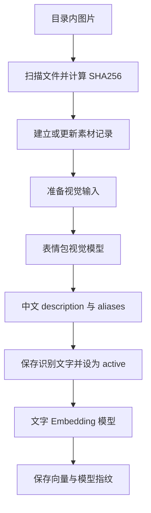

# HDSI 表情包识别与导出说明

本说明对应当前本地增强版的表情包库，可作为重做项目时的参考。表情包先由视觉模型生成中文描述和标签，再由 Embedding 模型把这些文字转换为向量。现有结果可以直接导出，不需要重新调用识别模型。

## 1. 当前数据与导出文件

2026 年 10 月 7 日导出时，表情包表中有 **67 条 active 素材，全部有 1024 维向量**，这些向量使用同一个指纹。

| 内容 | 位置 |
| --- | --- |
| 图片目录 | `D:\HDSI\koishi-hdsi\data\hds-interlude\stickers` |
| 数据库 | `D:\HDSI\koishi-hdsi\data\koishi.db` |
| 表 | `interlude_sticker`，全局素材库，不属于某个故事的记忆 |
| 完整识别目录和向量 | [sticker-catalog.json](runtime/sticker-export-20261007/sticker-catalog.json) |
| 单独向量 | [sticker-embeddings.json](runtime/sticker-export-20261007/sticker-embeddings.json) |
| 可用 Excel 打开的描述清单 | [sticker-descriptions.csv](runtime/sticker-export-20261007/sticker-descriptions.csv) |
| 可再次运行的导出脚本 | [export-sticker-embeddings.py](tools/export-sticker-embeddings.py) |

导出的是数据库里现有的识别结果。JSON 不包含图片二进制，`filePath` 是相对图片目录的路径。CSV 便于查看中文描述和标签，完整浮点向量保存在 JSON 中。

导出脚本只读取表情包表，不导出聊天、故事记忆或运行凭据，也不修改数据库。默认只导出 `active` 素材；以后新增但尚未识别的 `pending` 素材不会被当成可用素材导出。

## 2. 重新获取数据

在 PowerShell 中执行：

```powershell
python D:\HDSI\tools\export-sticker-embeddings.py
```

默认在 `D:\HDSI\runtime` 下建立带当前时间的新导出目录。也可以指定位置：

```powershell
python D:\HDSI\tools\export-sticker-embeddings.py --output D:\HDSI\runtime\my-sticker-export
```

指定同一个输出目录再次运行，会更新其中的三个导出文件。脚本使用 Python 标准库，不需要另装依赖，不调用模型，也不需要停止 Koishi。

若使用 SQLite 查看工具，可打开数据库并执行以下查询查看识别结果和向量：

```sql
SELECT assetId, filePath, description, aliases, embedding, embeddingFingerprint
FROM interlude_sticker
WHERE status = 'active'
ORDER BY filePath;
```

`embedding` 在库中是 JSON 数组。单独导出时应保留 `assetId`，否则无法知道每个向量对应哪张图。

## 3. 素材进入表情包库

现有实现有两个入口：

1. 手动把 PNG、JPG、JPEG、WebP、GIF 放进表情包目录及其子目录。扫描器递归到第三层子目录。
2. 开启 QQ 商城表情采集后，接收机器人自身发出的、带商城元数据的 OneBot 私聊发送事件，下载图片到 `qq-market/<表情包编号>/<表情编号>.<扩展名>`。并保存同名 `.meta.json`，其中的 `semanticLabel` 是商城提供的语义标签。

普通用户发来的任意图片不会因此自动加入可发送素材库。采集模式用于商城表情素材导入，收到图片后的当轮视觉理解是另一条流程。

插件启动和定时扫描都会检查目录，采集素材后也会请求扫描。扫描间隔、单文件大小上限和每批描述数量由 `stickers` 配置控制，代码默认分别为 5 分钟、10 MB、5 张；这些是默认值，不代表本机所有参数的实时值。

## 4. 从图片到识别文字



### 4.1 检查素材变化

程序按 `filePath` 找到已有记录，读取图片并计算 SHA256。相同内容、已识别为 `active`、商城语义标签未改变的文件会跳过重复识别。新图或变更图先保存为 `pending`，等待视觉描述。

素材的 `assetId` 由相对路径和图片哈希共同生成。移动、重命名或替换图片可能改变素材 ID，因此迁移时应保留目录结构和原有 ID。

### 4.2 准备图片输入

图片转换为 Base64 data URI。动态图片会尝试通过浏览器抽帧，再交给视觉模型；它并不是逐帧理解整段动画。图片也会尝试按视觉配置缩小。视觉调用收到图片、文件名、MIME、是否为动图，以及可选的商城语义标签。

### 4.3 视觉模型的任务

模型连接通过 `useForStickers` 指定表情包描述用途。当前调用取该任务分配列表中的第一个模型，以温度 0.2 请求结构化结果。`json-object` 模式会设置 JSON 响应格式；`prompt-only` 模式只由提示词要求输出 JSON，两种模式都解析同一结构。

识别内容包括画面主体、姿态或动作，以及可能的聊天用途。提供商城语义标签时，以该标签确定表达意图，图片用来补充具体表现，避免把含糊动作解释成相反情绪。

输出结构示例（仅说明格式）：

```json
{
  "description": "一只小猫挥手，适合打招呼或道别。",
  "aliases": ["挥手", "打招呼", "再见"]
}
```

程序保存最多 180 字符的 `description`；每个标签最多 32 字符，总共最多 5 个。若有商城标签，会优先放进 `aliases` 并去重。描述有效后，素材变为 `active`。

## 5. 从识别文字到 embedding

启用 `model.embedding.semanticStickerFilter` 后，Embedding 的输入为：

```text
description + 一个空格 + aliases 用空格连接
```

首尾空白会去掉，实际请求还受 Embedding 配置的最大输入字符数限制。模型返回的数值数组直接保存在 `embedding`；导出脚本中的 `embeddingInput` 是按现有描述和标签重建的文字，不是额外保存的历史请求日志。

新描述完成后会立即尝试生成向量。扫描也会为没有兼容向量的已识别素材补建向量，每次最多处理 8 条。识别文字与向量是分别存储的，因此有中文描述并不必然代表已经有向量。

`embeddingFingerprint` 用来标识向量生成配置及实际维数。指纹涉及模型、接口身份、请求维数和输入长度等信息的哈希，不能从指纹反解模型名称。

**向量维数相同不代表可以混用。** 在新项目中检索这些向量，应使用同一套兼容的 Embedding 模型和输入配置来生成查询向量。更换 Embedding 模型后，可以复用图片和中文描述，再重新生成向量，无需重复识图。

## 6. 回复时如何使用

现有实现先为当前回合构造查询向量，再按余弦相似度对表情包向量排序。启用语义过滤、查询向量可用且图库超过 12 张时，候选数量最多为 `min(12, catalogLimit)`。没有查询向量或关闭过滤时，候选按目录缓存顺序取到 `catalogLimit`；不兼容的素材向量不参与有效相似度计算。

交给回复模型的是候选素材 ID、中文描述、标签、分组和动图标记，不是那一千多个浮点数。模型提出素材 ID 和使用意愿，宿主按表达选择规则决定是否发送。已有实现还会在可见候选中，对向量相似度不低于 0.94 的相近素材随机选一个变体。

最终发送时根据素材记录中的相对路径读取本地图片。

## 7. 重做项目时如何复用

保留图片目录和 `sticker-catalog.json`，即可拥有“图片—识别描述—标签—向量”的对应关系。只看向量时可用 `sticker-embeddings.json`，通过 `assetId` 与完整目录关联。

新项目可以把完整目录作为独立素材索引导入，无需继承旧故事、聊天或记忆表。若不沿用原 Embedding 模型，使用导出的 `description` 和 `aliases` 重新建立文本向量即可。

## 8. 与收到图片的识别区别

表情包库识别是可复用素材的离线建档。用户在聊天中发来的图片，则作为当前消息的图片输入：文本旁路识图时由视觉模型输出当轮观察，原生视觉模式则可直接交给支持图片的叙事模型。不能把这些当轮观察等同于已经入库的表情包描述与向量。

## 9. 实现入口

- [素材扫描、描述、向量建立与候选目录](hds-interlude-integration-0.1.4/src/interaction/sticker-library.ts)
- [文件遍历、商城语义标签与相似度计算](hds-interlude-integration-0.1.4/src/interaction/sticker-assets.ts)
- [视觉输入处理](hds-interlude-integration-0.1.4/src/interaction/media.ts)
- [表情包视觉模型调用](hds-interlude-integration-0.1.4/src/models/visual-client.ts)
- [识别提示与输出格式](hds-interlude-integration-0.1.4/src/narrative/visual-contracts.ts)
- [Embedding 请求](hds-interlude-integration-0.1.4/src/models/embedding.ts)
- [向量指纹与兼容判断](hds-interlude-integration-0.1.4/src/memory/semantic-index.ts)
- [表情包数据库结构](hds-interlude-integration-0.1.4/src/storage/schema.ts)

本次仅导出已有数据并整理说明，没有更改模型、运行配置或识别流程。
